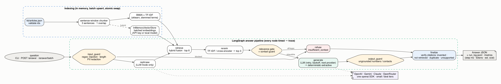
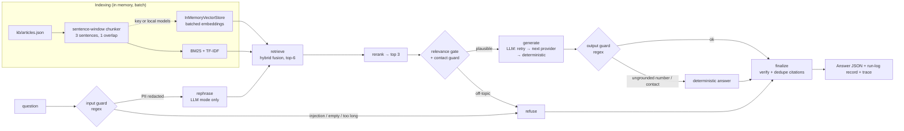
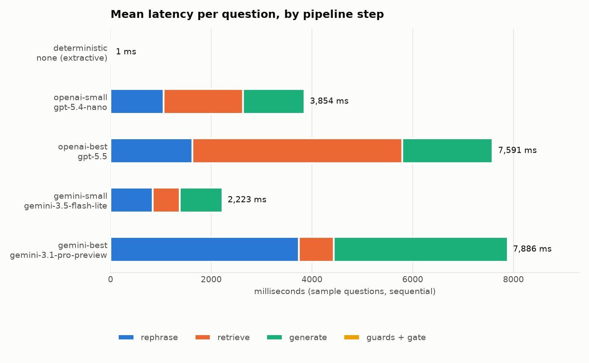
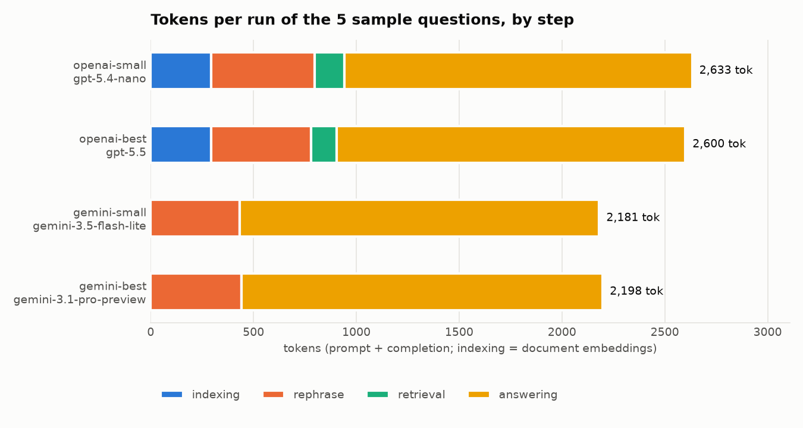
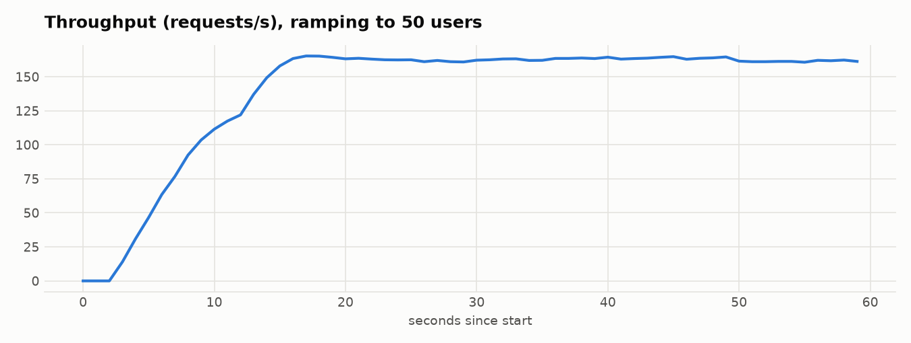
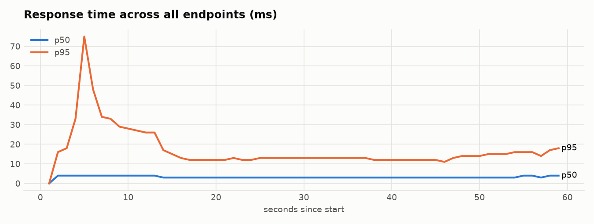

# Grounded Support Assistant

A small, runnable AI support assistant. It answers product-support questions **only** from
`kb/articles.json`, cites the article IDs it used, and refuses with
`"insufficient_context": true` when the knowledge base does not support an answer.

It runs from a clean checkout **with no API keys** (deterministic fallback mode). When a key
for OpenAI, Gemini, Anthropic (Claude) or OpenRouter is present, it switches to LLM mode with
hybrid retrieval.

- Specs and design notes, written before coding: [`docs/specs/SPEC.md`](docs/specs/SPEC.md)
- The brief, saved as received: [`docs/specs/problem-statement.md`](docs/specs/problem-statement.md)
- Architecture decisions: [`docs/llm/decisions/`](docs/llm/decisions/) · map for agents: [`docs/llm/INDEX.md`](docs/llm/INDEX.md)

## Quick start (no API key needed)

```bash
python3 -m venv .venv && source .venv/bin/activate
pip install -r requirements.txt          # core only: no torch, no model downloads

python main.py                           # full pipeline on the sample data → artifacts/
python validate.py                       # checks inputs and artifacts, exit code 0 = pass
python -m pytest -q                      # unit + API tests (offline)
```

With `make` (run `make help` for every target):

| Command | What it does |
|---|---|
| `make setup` | create `.venv`, install core requirements |
| `make run` | full pipeline on `questions.json` → `artifacts/` (LLM mode if a key is set) |
| `make run-offline` | same, forced deterministic fallback |
| `make validate` | `python validate.py` |
| `make test` | offline unit + API tests (keys unset for the run) |
| `make all` | `run-offline` + `validate` + `test`: what a grader needs |
| `make serve` / `make serve-offline` | API on `http://127.0.0.1:8000` |
| `make loadtest` | Locust, headless, against a running server |
| `make benchmark` / `make charts` | per-mode latency and token benchmark, then the README charts |
| `make test-live` | live LLM smoke test (uses your keys) |
| `make docker-build` / `make docker-run` | container on port 8000 |

### Expected output (deterministic mode)

```text
[Q1] ANSWERED ['ART-101'] via deterministic-lexical: Users can reset their password from the login page by selecting Forgot password. A reset link is valid for 15 minutes. If a user requests multiple reset emails, only the latest link remains valid.
[Q2] ANSWERED ['ART-102'] via deterministic-lexical: If a user loses access to their authenticator app, they must complete identity verification before 2FA can be removed. Support cannot bypass identity verification.
[Q3] ANSWERED ['ART-301'] via deterministic-lexical: Public API requests are limited to 120 requests per minute per token. When the rate limit is exceeded, the API returns HTTP 429. Clients should implement exponential backoff and retry with jitter.
[Q4] ANSWERED ['ART-302'] via deterministic-lexical: Webhook events are delivered at least once.
[Q5] REFUSED  [] via relevance-gate: I can't answer that from the support knowledge base. Please contact the support team so an agent can help.
[eval] sample: 5/5 passed | robustness: 20/20 passed
```

## LLM mode or fallback mode?

**Both are implemented, and the committed `artifacts/` were produced in fallback mode**, so
a grader without keys gets identical files. An LLM run is committed alongside for comparison
in [`artifacts/llm_openai/`](artifacts/llm_openai/).

| | Deterministic fallback (default, no key) | LLM mode (any key set) |
|---|---|---|
| Retrieval | BM25 (in code, in memory) | hybrid: BM25 + dense vectors (API embeddings), plus an LLM query rephrase |
| Rerank | TF-IDF uni+bigram cosine (model-free) | same (cross-encoder with `USE_LOCAL_MODELS=1`) |
| Answer | extractive: the top chunk's sentences that match the question | LLM, JSON output, a prompt that forbids outside knowledge |
| Refusal | relevance gate + contact-detail guard | the same gate, plus the LLM's own `insufficient_context` |
| Cost | $0 | ≈ $0.001 per 5 questions on the small tier |

Optional (`USE_LOCAL_MODELS=1`, `pip install -r requirements-local-models.txt`): BERT SQuAD2
extractive QA, which can say "no answer", plus sentence-transformers vectors (hybrid retrieval
without a key) and a cross-encoder reranker. These are off by default, so the grader never
downloads torch or ~0.6 GB of weights.

### Providers and models (November 2026)

One SDK (`openai`) serves all four providers, because each exposes an OpenAI-compatible
endpoint. `LLM_TIER=small` (default, cheap) or `LLM_TIER=best`. `<PROVIDER>_MODEL` overrides
the tier choice.

| Provider | Key | `small` | `best` | Embeddings |
|---|---|---|---|---|
| OpenAI | `OPENAI_API_KEY` | `gpt-5.4-nano` | `gpt-5.5` | `text-embedding-3-small` / `-large` |
| Google | `GEMINI_API_KEY` | `gemini-3.5-flash-lite` | `gemini-3.1-pro-preview` | `gemini-embedding-001` |
| Anthropic | `ANTHROPIC_API_KEY` | `claude-haiku-5-5` | `claude-opus-5-5` | none (lexical, or local vectors) |
| OpenRouter | `OPENROUTER_API_KEY` | `openai/gpt-5.4-nano` | `anthropic/claude-opus-5.5` | none |

OpenAI and Gemini were run end to end (below). The Anthropic and OpenRouter IDs follow each
provider's published naming but were **not** called, because no keys for them were available.
When several keys are set, the router tries `LLM_PROVIDER` first, then openai → gemini →
anthropic → openrouter, and finally the deterministic answerer.

Calls request determinism (`temperature=0`, low or no reasoning effort). If a model rejects a
parameter, for example `gpt-5.5` with `temperature=0`, the client drops it and retries once,
then remembers that for the model. Failures retry with **exponential backoff and jitter**
(`LLM_MAX_ATTEMPTS`, `LLM_BACKOFF_BASE_S`, `LLM_BACKOFF_MAX_S`). `Retry-After` is honoured,
auth, permission and 404 errors are not retried, and `LLM_MIN_INTERVAL_S` spaces out calls.

Keys go in `.env` (git-ignored). See [`.env.example`](.env.example).

## Architecture



<sub>Source: [`docs/architecture.dot`](docs/architecture.dot). The same flow as Mermaid, rendered by GitHub:</sub>



Every box after the question is a node in a **LangGraph** `StateGraph`
([`app/graph.py`](app/graph.py)). Each node is wrapped by a timing middleware that writes its
wall time into the request trace.

| Module | Responsibility |
|---|---|
| [`app/data_utils.py`](app/data_utils.py) | load and validate KB and questions, sentence chunking, tokeniser (stop words, 5-char stemming) |
| [`app/indexer.py`](app/indexer.py) | in-memory index: BM25, TF-IDF, LangChain `InMemoryVectorStore`, batched query embeddings |
| [`app/retrievers.py`](app/retrievers.py) | `HybridRetriever` (a LangChain `BaseRetriever`): fusion + rerank, top 3 |
| [`app/llm_utils.py`](app/llm_utils.py) | providers, tiers, prompts (LangChain `ChatPromptTemplate`), retries and backoff, embeddings |
| [`app/qa_fallback.py`](app/qa_fallback.py) | deterministic extractive answerer (optional BERT QA) |
| [`app/local_models.py`](app/local_models.py) | optional BERT QA, sentence-transformers, cross-encoder (lazy, fail-soft) |
| [`app/guardrails.py`](app/guardrails.py) | input and output regex guards, relevance gate, citation verification |
| [`app/tracing.py`](app/tracing.py) | per-request trace (step timings, tokens, cost), process metrics |
| [`app/output_utils.py`](app/output_utils.py) | artifact writers |
| [`app/api.py`](app/api.py) | async FastAPI service |
| [`main.py`](main.py) · [`evaluate.py`](evaluate.py) · [`validate.py`](validate.py) | entry point · evaluation · validation |

## Guardrails

| Stage | Check | Action |
|---|---|---|
| input | empty, > 1000 chars, prompt-injection patterns (`ignore previous instructions`, `system prompt`, `<system>`…) | refuse; the LLM is never called |
| input | email, phone, card, IBAN, API key | redacted (`[EMAIL]`…) before retrieval, the LLM and the logs |
| gate | idf-weighted share of question terms found in the top chunk (≥ 3 matched terms, or ≥ 2 matched with ≥ 0.4 coverage, or ≥ 0.75 coverage); in hybrid mode dense similarity ≥ 0.55 also passes | refuse without calling a generator. In LLM mode the gate is lenient: any overlap or dense ≥ 0.35 goes to the LLM |
| gate | the question asks for contact details and the context has none | refuse |
| output | an email, phone or URL, or a **number** not present in the retrieved context or the question | replace the LLM answer with the extractive answer, or refuse |
| citations | normalise (`[art-101]` → `ART-101`); drop **invented** (not in KB), **not retrieved**, **duplicate**, and **unsupported** (cited text shares no terms with the answer) | cleaned list, and the drops are logged as a `citations_cleaned` event |
| finalize | an answer with no surviving citation, or a refusal that still carries citations | becomes a refusal with `citations: []` and fixed refusal text |

The thresholds were calibrated on the 5 sample questions **and** 20 held-out questions
([`eval/extra_questions.json`](eval/extra_questions.json): 12 paraphrases and 8 out-of-scope
questions), so that swapped-in equivalent questions keep working. Every mode scores 20/20 on
that set.

## Artifacts

| File | Content |
|---|---|
| `artifacts/index_preview.json` | retrieval records `{chunk_id, article_id, title, product, text}` |
| `artifacts/retrieval_results.json` | top-3 chunks with scores per question |
| `artifacts/answers.json` | `{question_id, answer, citations, insufficient_context}` |
| `artifacts/eval_summary.json` | sample-question metrics + robustness section + run mode |
| `artifacts/run_log.jsonl` | one line per question: required fields, plus provider, step timings, tokens per step, est. cost, events |
| `artifacts/run_info.json` | mode, embedder, index-build stats, per-question score breakdown |
| `artifacts/llm_openai/` | the same set produced in LLM mode (`gpt-5.4-nano`) |
| `artifacts/benchmarks/benchmark.json` | per-mode latency, tokens and cost (source of the charts) |

## API

```bash
make serve            # or: python main.py --serve --port 8000
```

| Endpoint | |
|---|---|
| `POST /answer` | `{"question": "...", "question_id": "optional"}` → same shape as `answers.json` |
| `POST /answer/batch` | `{"questions": [...]}` (≤ 100), answered concurrently (`MAX_CONCURRENCY`), order kept |
| `POST /query` | retrieval only: top-3 chunks with scores |
| `POST /index` | `{"articles": [...], "mode": "append"\|"replace"}` batch upsert, or `{}` to reload from disk. The index is rebuilt and swapped atomically, and in-flight requests finish on the old index |
| `GET /health` | mode, providers, embedder, index size and build cost |
| `GET /metrics` | rolling p50/p95/max per pipeline step and per HTTP route, token and cost counters |
| `GET /docs` | Swagger UI. **"Try it out" sends real requests**, with the sample questions prefilled |
| `GET /redoc` | ReDoc reference (ReDoc is read-only by design and cannot send requests) |
| `GET /scalar` | ReDoc-style reference that *can* send requests (Scalar, loaded from a CDN) |

Every response carries `X-Request-ID` and `X-Process-Time-Ms` headers. All endpoints are
`async`; pipeline work runs in worker threads.

```bash
curl -s localhost:8000/answer -H 'content-type: application/json' \
  -d '{"question": "Are webhooks exactly once?"}'
# {"question_id":"REQ-…","answer":"Webhook events are delivered at least once.","citations":["ART-302"],"insufficient_context":false}
```

## Observability: timing, tokens and cost

Each question gets a trace. Graph nodes are timed by a middleware wrapper, and every chat or
embedding call records its tokens, latency and estimated cost **against the step that made
it**. Index builds are traced the same way (document-embedding tokens). The result goes to
`run_log.jsonl`, `/metrics` and `/health`.

### Latency per step: sample questions, run one at a time



| Mode | Model | Retrieval | Correct | Rephrase ms | Retrieve ms | Generate ms | Guards + gate ms | Total ms |
|---|---|---|---|---|---|---|---|---|
| deterministic | `none (extractive)` | lexical | 5/5 | 0 | 1 | 0 | 0.1 | 1 |
| openai-small | `gpt-5.4-nano` | hybrid | 5/5 | 1,052 | 1,575 | 1,227 | 0.2 | 3,612 |
| openai-best | `gpt-5.5` | hybrid | 5/5 | 1,622 | 4,169 | 1,800 | 0.3 | 7,235 |
| gemini-small | `gemini-3.5-flash-lite` | hybrid | 5/5 | 833 | 545 | 844 | 0.2 | 2,057 |
| gemini-best | `gemini-3.1-pro-preview` | hybrid | 5/5 | 3,735 | 699 | 3,452 | 0.3 | 7,199 |

`retrieve` in LLM mode is dominated by one query-embedding round trip; the original and
rephrased queries are embedded in a single batched call. The guards and the gate cost under
half a millisecond.

### Tokens per step: indexing, rephrase, retrieval, answering



| Mode | Model | Embedder | Indexing | Rephrase | Retrieval | Answering | Est. cost (5 questions + index) |
|---|---|---|---|---|---|---|---|
| openai-small | `gpt-5.4-nano` | text-embedding-3-small | 294 | 504 | 145 | 1,690 | $0.0008 |
| openai-best | `gpt-5.5` | text-embedding-3-large | 294 | 485 | 126 | 1,695 | $0.0195 |
| gemini-small | `gemini-3.5-flash-lite` | gemini-embedding-001 | 0* | 434 | 0* | 1,747 | $0.0013 |
| gemini-best | `gemini-3.1-pro-preview` | gemini-embedding-001 | 0* | 441 | 0* | 1,757 | $0.0077 |

\* Gemini's OpenAI-compatible embeddings endpoint returns no usage block, so its embedding
tokens are not counted.

**Cost estimates** come from a USD-per-1M-token table in [`app/tracing.py`](app/tracing.py).
It was compiled on 2026-11-02 from third-party price trackers, not the providers' own pages.
Override it with `LLM_PRICES_JSON`. Re-generate with `make benchmark && make charts`.

## Load test (Locust)

```bash
make serve-offline            # terminal 1: deterministic mode, so no API cost
make loadtest                 # terminal 2: 50 users, ramp 10/s, 60 s
```

[`locustfile.py`](locustfile.py) mixes `/answer` (6), `/query` (3), `/answer/batch` (1) and
`/health` (1), and checks that every `/answer` response has the schema. Results in
deterministic mode, single uvicorn worker, 50 users for 60 s:




| Endpoint | Requests | Failures | req/s | p50 ms | p95 ms | p99 ms | max ms |
|---|---|---|---|---|---|---|---|
| POST /answer | 5,017 | 0 | 84.9 | 4 | 14 | 33 | 124 |
| POST /answer/batch | 858 | 0 | 14.5 | 10 | 26 | 49 | 114 |
| POST /query | 2,542 | 0 | 43.0 | 2 | 12 | 30 | 116 |
| GET /health | 894 | 0 | 15.1 | 1 | 6 | 15 | 36 |
| **Aggregated** | **9,311** | **0** | **157.6** | **3** | **15** | **34** | **124** |

The p95 spike in the first seconds is the 50-user ramp plus first-request warm-up. Pointing
the load test at an LLM-mode server would make every request a billed API call, and
throughput would then be bound by provider latency (2–7 s per question, see above).

## Tests, style and CI

```bash
make test        # 37 offline tests: retrieval, refusal, guardrails, fallback, retries, API, docs pages
make test-live   # real provider round trip (skipped without keys)
make test-local  # optional BERT/sentence-transformer path (USE_LOCAL_MODELS=1)
```

The LLM path is tested offline with a fake router. Those tests cover invented and duplicate
citations being cleaned, provider failure falling back to the deterministic answerer, an
invented number being caught by the output guard, the LLM never being called for unrelated
questions, and backoff timing.

Style: `black` (line length 120) and `flake8`, run by **pre-commit**
(`pip install pre-commit && pre-commit install`). **GitHub Actions**
([`.github/workflows/ci.yml`](.github/workflows/ci.yml)) runs on every pull request and every
push to `main`. It checks style, runs the pipeline from a clean checkout without keys, then runs
`validate.py` and the test suite.

## Docker

A multi-stage build: dependencies go into a virtualenv in a builder stage, and the slim
runtime stage gets only that virtualenv and the app code. It runs as non-root, has a
healthcheck, and leaves out test-only packages (731 MB single-stage → 549 MB).

```bash
docker build -t grounded-support-assistant .
docker run --rm -p 8000:8000 grounded-support-assistant                  # deterministic
docker run --rm -p 8000:8000 --env-file .env grounded-support-assistant  # LLM mode
```

## Assumptions and trade-offs

- **Lexical-first refusal.** The relevance gate is deterministic and runs before any LLM call.
  An unrelated question (Q5) costs nothing and cannot be talked into an answer. The price is
  that a paraphrase sharing no words with the KB is refused in fallback mode; LLM mode
  softens this with dense similarity and query rephrasing.
- **The extractive fallback answers in the KB's own words.** That makes it grounded by
  construction, but less conversational, and it may include an adjacent sentence from the
  same chunk.
- **Truncation stemming** (first 5 characters) instead of a stemmer library: no extra
  dependency, and it handles `verify/verifying/verification`. Rare collisions are possible.
- **Chunking** uses sentence windows (3 sentences, 1 overlap). The sample articles are 3–4
  sentences, so each makes 1–2 chunks; the code handles longer articles.
- **Everything is in memory**, as asked. Re-indexing rebuilds the whole index, which is fine
  at this size; a large KB would need incremental vector upserts and a persistent store.
- **Rephrasing** is used for retrieval only. The generator sees the user's own words, so a
  rephrase cannot inject facts into the answer.
- **Number grounding** in the output guard is strict. An LLM answer that converts "2 hours"
  into "120 minutes" is replaced by the extractive answer. That is safe, but conservative.
- **Prices are estimates** (see above), and the Anthropic and OpenRouter paths are untested
  live.
- **PII redaction** is regex-based and English-centric. It is a guard, not a DLP system.
