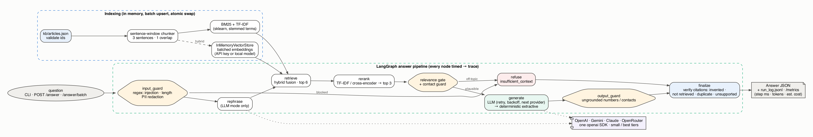

# Spec and design notes: Grounded Support Assistant

Status: written before coding, then updated with what was measured · Date: 2026-11-02

The brief is saved word for word in [problem-statement.md](problem-statement.md). The sample
inputs are in [sample-data/](sample-data/).

## 1. Objective

A local service that answers product-support questions **only** from `kb/articles.json`.
Each answer cites the article IDs it used, and the service refuses with
`insufficient_context: true` when the knowledge base does not support an answer. It must
run from a clean checkout with **no API keys** and produce the same output schema in both
modes:

| Mode | When | Retrieval | Answer generation |
|---|---|---|---|
| **LLM** | any of `OPENAI_API_KEY`, `GEMINI_API_KEY`, `ANTHROPIC_API_KEY`, `OPENROUTER_API_KEY` set | hybrid: BM25 + dense vectors (API embeddings), plus an LLM rephrase of the query | LLM in JSON mode, with a prompt that forbids outside knowledge. Retries with backoff, then the next provider, then the deterministic path |
| **Deterministic fallback** | no key, or every provider failed | BM25 (always works, no downloads), TF-IDF reranker | extractive: sentences of the top chunk that match the question |
| *+ local models (opt-in)* | `USE_LOCAL_MODELS=1` | hybrid with sentence-transformer vectors, cross-encoder rerank | BERT SQuAD2 extractive QA (can return "no answer") |

> **Revised during build.** The first draft made TF-IDF the retriever and BERT the default
> fallback. After review, BM25 became the retriever and TF-IDF the reranker, and local models
> became opt-in so a clean checkout never downloads torch (ADR-0003). Later additions: regex
> input and output guards, citation verification, async and batch API, tracing and cost, model
> tiers. See §11.

## 2. Requirements traceability

| Brief item | Where it is satisfied |
|---|---|
| 1. Load KB, keep `id/title/product`, chunk in code, `index_preview.json` | `app/data_utils.py` (load and chunk), `app/output_utils.py` (write) |
| 2. Retrieval in code, top 3, `retrieval_results.json` | `app/indexer.py` (in-memory BM25 + TF-IDF + `InMemoryVectorStore`), `app/retrievers.py` (hybrid fusion + rerank) |
| 3. Grounded JSON answers, citations, refusal, no-outside-knowledge prompt, deterministic fallback | `app/llm_utils.py` (prompt, providers), `app/qa_fallback.py`, `app/graph.py` |
| 4. Guardrails, dedupe citations, eval script, `eval_summary.json` | `app/guardrails.py`, `evaluate.py`, `eval/expected_sources.json` |
| 5. One command, validation | `python main.py` / `make run`; `python validate.py` / `make validate` |
| 6. Tests | `tests/` (pytest) |
| 7. `run_log.jsonl` | `app/output_utils.py` |
| 8. API | `app/api.py`: `POST /index`, `POST /query`, `POST /answer`, `GET /health` |

## 3. Architecture



Everything runs in memory: the BM25 statistics, the TF-IDF matrix, the vector store, and the graph state. Nothing
is persisted except the JSON artifacts.

```text
kb/articles.json ──load──► Article[] ──chunk──► Chunk[] ──► Index (in memory)
                                                         ├─ BM25 + TF-IDF (sklearn)
                                                         └─ InMemoryVectorStore (langchain-core), only when a dense embedder is available

question ─► LangGraph StateGraph
   rephrase   LLM rewrites the question into a search query (LLM mode only; it is used for retrieval, never shown to the user)
   retrieve   hybrid score = w·TF-IDF + (1-w)·dense (min-max normalised); original + rephrased queries fused by max
   rerank     cross-encoder (ms-marco MiniLM) when available, else keep the fused order → top 3
   gate       relevance gate: if the best chunk is clearly off-topic, go straight to refusal (the LLM is never asked)
   generate   LLM path (retry → next provider) ─on failure─► deterministic path
   guard      citations ⊆ retrieved article IDs ∩ KB IDs, deduped in rank order; refusal ⇒ citations = []; answered ⇒ ≥1 citation
   └─► Answer {question_id, answer, citations, insufficient_context} (+ run-log record)
```

### Chunking

Each article is split into sentence windows (default: up to 3 sentences, 1 sentence of
overlap). The sample articles have 3–4 sentences, so each one gives 1–2 chunks. Chunk ID:
`{article_id}-C{n}`. The title is prepended to the indexed text so title words count
toward retrieval, but the stored `text` is the raw chunk.

### Why a relevance gate exists in both modes

The brief's main failure case is Q5 ("CEO's direct email address"). The word *email*
appears in ART-101, so pure similarity will always return *something*. Refusal therefore
rests on three independent signals:

1. **Retrieval gate**: top relevance below a threshold → refuse without calling any generator.
2. **Generator judgement**: the LLM is told to return `insufficient_context: true` when
   the context does not contain the answer. The SQuAD2 BERT model returns "no answer"
   when no span beats the null score.
3. **Support check**: in the deterministic path, the selected sentences must cover the
   question's content terms (sentence-transformer similarity, or lexical coverage).

Thresholds are calibrated on the sample questions **plus** a held-out set of paraphrases
and out-of-scope questions (`eval/extra_questions.json`). This guards against the evaluator
swapping in equivalent questions (§7).

## 4. Schemas (pydantic, `app/schemas.py`)

- `Chunk {chunk_id, article_id, title, product, text}`, which is exactly the index preview record.
- `RetrievalResult {question_id, question, retrieved_chunks: [{chunk_id, article_id, score}]}`.
  Extra debug fields (`rerank_score`, `tfidf_score`, `dense_score`) are kept in
  `retrieved_chunks` only when the run is verbose. The required keys are always present.
- `Answer {question_id, answer, citations: [str], insufficient_context: bool}`.
- `RunLogRecord {question_id, retrieval_chunk_ids, used_fallback, timestamp}`, plus
  `provider`, `retrieval_mode`, `latency_ms`, `error`.

## 5. LLM layer (`app/llm_utils.py`)

- A single SDK: `openai`. OpenAI, Gemini (OpenAI-compatible endpoint), Anthropic
  (OpenAI-compatible endpoint) and OpenRouter differ only by `base_url`, key and model.
  Models can be overridden with `<PROVIDER>_MODEL`. Order: `LLM_PROVIDER` if set, else
  every provider with a key, in the order openai → gemini → anthropic → openrouter.
- `temperature=0`, JSON output, schema validated with pydantic. Each provider gets 2 attempts
  with exponential backoff and jitter. Invalid JSON counts as a failed attempt. When every
  provider fails, the deterministic generator answers and `used_fallback=true`.
- The prompt states: *use only the numbered context; do not use outside knowledge; do not
  invent policies, people, contact details or steps; cite article IDs you used; if the
  context does not answer, set insufficient_context true.*
- Embeddings: OpenAI `text-embedding-3-small` or Gemini `gemini-embedding-001` through the
  same client. Anthropic and OpenRouter have no embeddings endpoint, so they use local
  sentence-transformers.

## 6. Guardrails (`app/guardrails.py`)

- Drop citations that are not in the KB or not among the retrieved chunks. Then dedupe,
  keeping first-seen order. Conflicting output, such as an answer with no surviving
  citations or a refusal that still has citations, is normalised: an "answer" with no
  valid citation becomes a refusal, and a refusal has `citations=[]`.
- Refusal text is fixed, with no invented contact routes: *"I can't answer that from the
  support knowledge base. Please contact the support team so an agent can help."*
- Answers are trimmed to a short length. The same post-processing runs on both paths.

## 7. Evaluation (`evaluate.py`) → `artifacts/eval_summary.json`

- `eval/expected_sources.json` maps **question text** (not just the ID) to the expected
  article IDs, or to `"unsupported"`. Questions without a label are reported as
  `unlabelled` and are not failed.
- Metrics: supported-question citation hit rate (≥1 expected article cited), retrieval
  recall@3, unsupported-question refusal rate, citation validity, and pass/fail per question.
- The extra robustness set (paraphrases and out-of-scope questions) is evaluated as a
  separate section so it never changes the required artifacts.

## 8. Validation (`validate.py`)

It checks that inputs exist, artifacts exist and parse, the required fields and types are
present, every citation is a KB article ID, the retrieval results have ≤3 chunks, the run
log has one valid line per question, and Q5 (found by ID, and also by question text) has
`insufficient_context: true`. It exits non-zero on any failure.

## 9. Test plan (`tests/`)

| Test | Covers |
|---|---|
| password-reset question → ART-101 ranked first | retrieval |
| top-k = 3, scores are descending floats | retrieval contract |
| Q5 and other out-of-scope questions → `insufficient_context` | refusal (deterministic) |
| guardrail dedupes and drops unknown or unretrieved citations | citation cleaning |
| LLM path with a fake provider that returns an invented citation / bad JSON / an exception → cleaned / retried / fallback | retries and fallback, no network |
| API `/index`, `/query`, `/answer` via TestClient | service |
| live provider smoke test (skipped unless keys are present) | real LLM path |

## 10. Risks and trade-offs

| Risk | Mitigation |
|---|---|
| Thresholds overfit to 5 questions | calibrated on the extra paraphrase/out-of-scope set too; values documented in the README |
| Model download fails on a clean checkout | every local model is optional; the lexical deterministic path needs only scikit-learn |
| LLM cites an article it didn't use, or one it never saw | guardrail intersects citations with the retrieved IDs |
| Query rephrasing brings in outside knowledge | the rephrased query is used only for retrieval; the generator sees the original question |
| Provider model names change | each one can be overridden with `<PROVIDER>_MODEL` |
| Secrets leak into a public repo | `.env` is git-ignored; only `.env.example` is committed; artifacts never contain keys |

## 11. What changed while building (revision log)

| Change | Why |
|---|---|
| Retriever TF-IDF → **BM25**; TF-IDF kept as the model-free **reranker** | owner request; BM25 handles short queries with term saturation and length normalisation |
| Local models (BERT QA, sentence-transformers, cross-encoder) → **opt-in** (`USE_LOCAL_MODELS=1`) | clean-checkout install must not need torch or ~0.6 GB of downloads |
| Relevance gate gained a "≥ 3 matched terms" rule and a short support-specific stop list | Q1 ("came twice… how long does it work") was refused because filler words diluted coverage |
| sklearn stop words `once/only/first/…` kept as terms | "exactly once" (Q4) depends on them |
| Regex **input guard** (injection, length, PII redaction) and **output guard** (ungrounded numbers or contacts → extractive answer) | owner request; defence in depth on top of the prompt |
| Citation verification: invented / not-retrieved / duplicate / unsupported, with normalisation | owner request; each drop is logged as an event |
| `small` / `best` model tiers per provider (Nov 2026 models), parameter dropping for models that reject `temperature` | `gpt-5.5` rejects `temperature=0` |
| Async endpoints, `/answer/batch`, batch upsert `/index`, atomic index swap | owner request; concurrent requests during re-index |
| Tracing: per-node timing middleware, tokens and cost per step, `/metrics`, HTTP timing headers | owner request |
| Locust load test, benchmark charts, Docker (multi-stage), Makefile, pre-commit, CI | owner request |

Measured results are in the README (latency per step, tokens per step, load test).
